<div align="center">

# 🔍 ResumeLens AI

### Advanced ATS Resume Parser & Intelligence Platform

Upload a resume → get structured data, an **ATS readiness score**, and a **job-description match** in seconds.

[](https://resumelens-ai-shreeya.onrender.com/)
[](LICENSE)


[**Live Demo**](https://resumelens-ai-shreeya.onrender.com/) · [**Demo Video (MP4)**](docs/demo.mp4) · [**Report Bug**](https://github.com/ShreeyaTapaswi/ResumeLens-AI/issues)

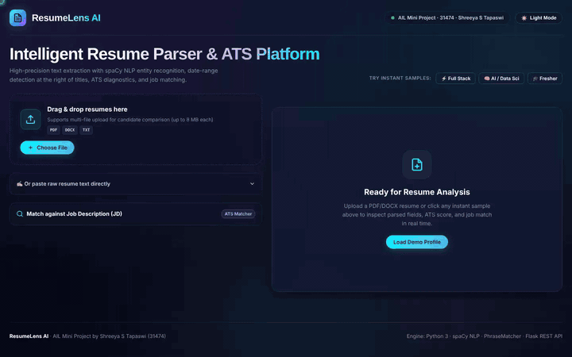

</div>

---

> **AIL Mini Project** by **Shreeya S Tapaswi (31474)**

## ✨ Features

| | |
|---|---|
| 📄 **Multi-format parsing** | PDF (`pdfplumber`, multi-column aware), DOCX (incl. tables), TXT |
| 🧑 **Candidate details** | Name (header heuristics + spaCy NER), email, phone, LinkedIn / GitHub / LeetCode / portfolio |
| 🧠 **Skill taxonomy** | 7 categories via spaCy `PhraseMatcher` with aliases (`k8s`, `js`, `sklearn`, `genai`…) |
| 💼 **Work timeline** | Date-range parsing, non-overlapping experience merger, titles, orgs, metric detection |
| 🎓 **Education & projects** | Degrees, institutions, GPA/CGPA, project tech stacks, certifications |
| 📊 **ATS diagnostics** | 9-point score breakdown + actionable recommendations |
| 🎯 **JD matcher** | Match %, matched vs. missing skills, one-click *Copy Missing Skills* |
| 🆚 **Resume comparison** | Side-by-side matrix with a 👑 top pick |
| 📤 **Export** | JSON download, copy summary, print-ready report |
| 🌗 **Dark / light UI** | Glassmorphism interface with an interactive document inspector |

## 📸 Screenshots

<table>
<tr>
<td width="50%">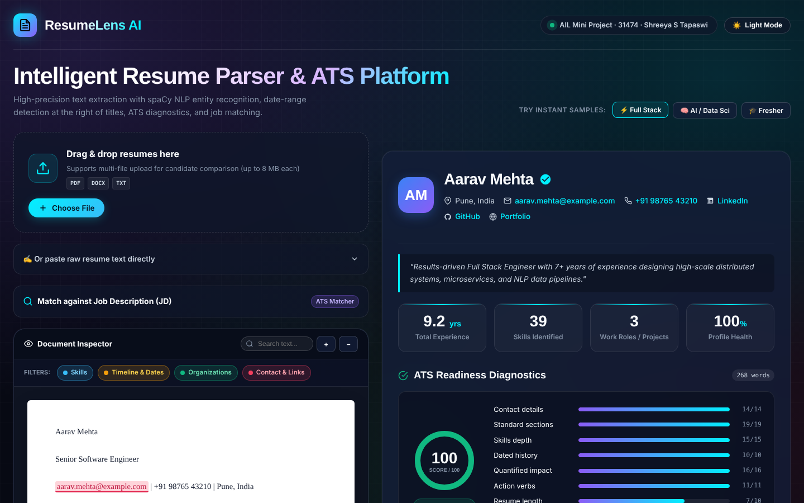<br/><sub><b>Parsed profile & document inspector</b></sub></td>
<td width="50%">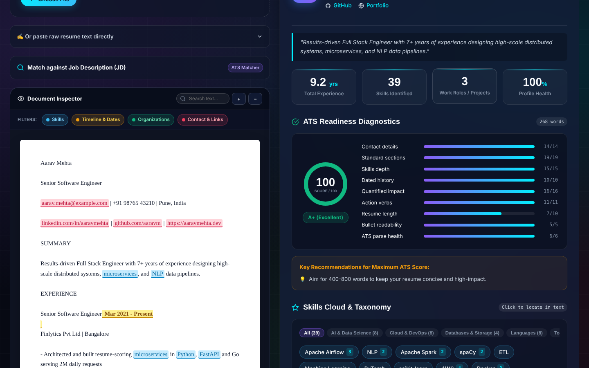<br/><sub><b>ATS readiness diagnostics</b></sub></td>
</tr>
<tr>
<td>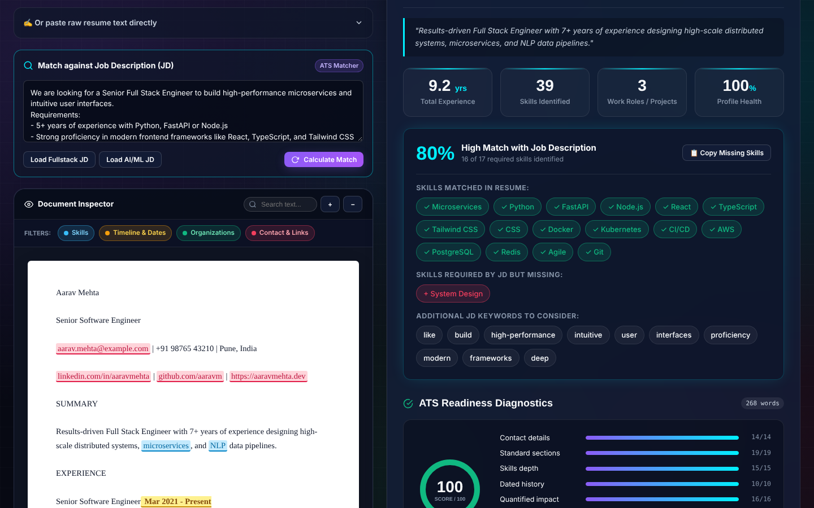<br/><sub><b>Job description match</b></sub></td>
<td>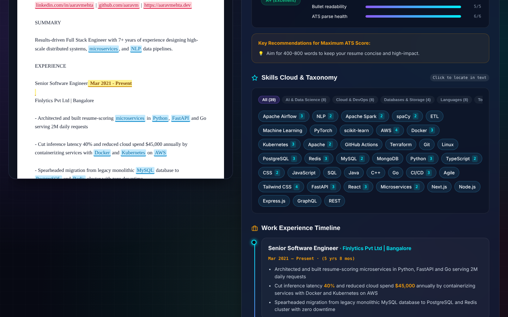<br/><sub><b>Categorised skills</b></sub></td>
</tr>
<tr>
<td>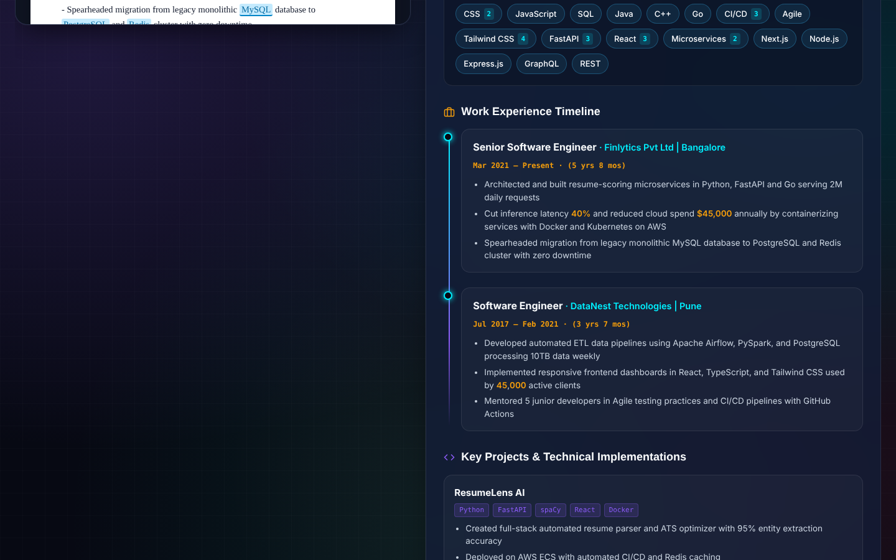<br/><sub><b>Experience timeline</b></sub></td>
<td>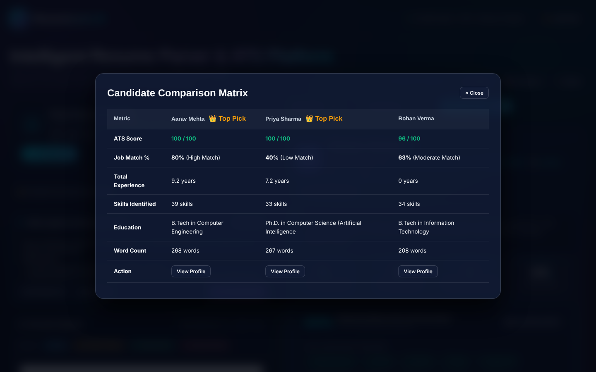<br/><sub><b>Candidate comparison matrix</b></sub></td>
</tr>
</table>

<details>
<summary>🌗 Light mode & landing page</summary>

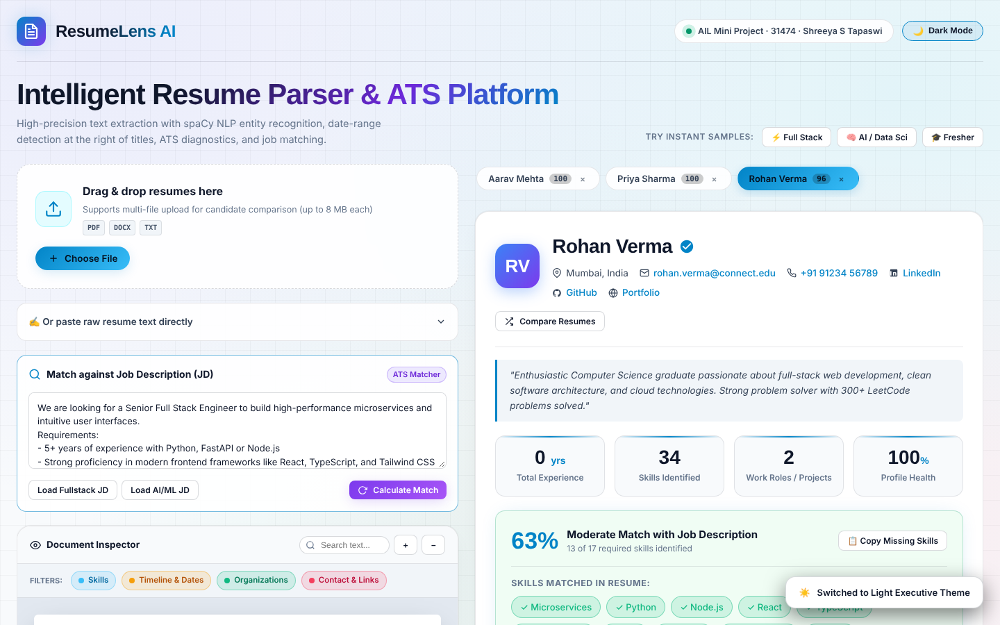
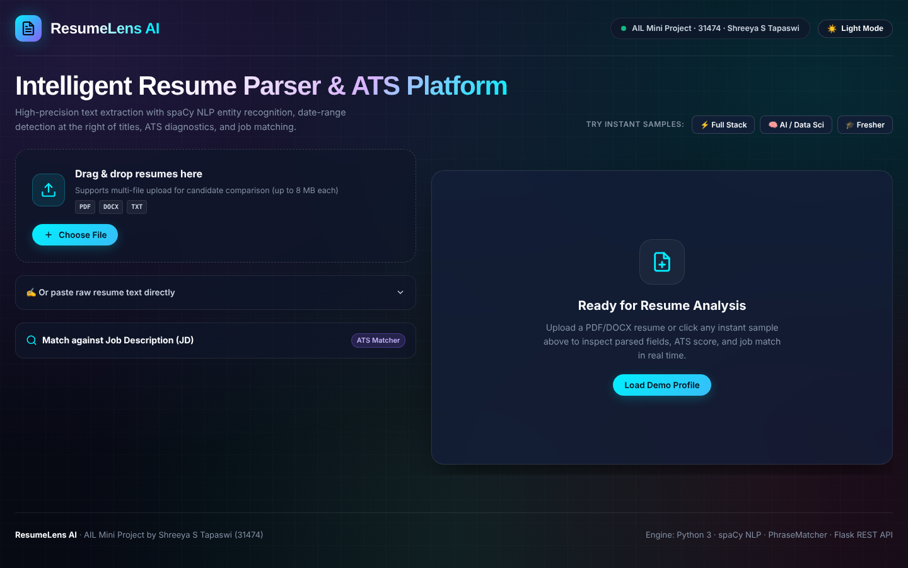

</details>

## 🏗️ How It Works

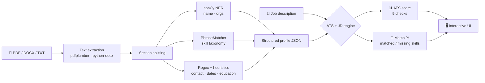

## 📊 Results

Measured by running the app on its 3 built-in sample resumes (JD match uses the built-in *Full Stack* job description):

| Candidate | ATS score | JD match | Experience | Skills found |
|---|:---:|:---:|:---:|:---:|
| Aarav Mehta (Full Stack) | **100** | **80%** | 9.2 yrs | 39 |
| Priya Sharma (AI / Data Sci) | **100** | **40%** | 7.2 yrs | 33 |
| Rohan Verma (Fresher) | **96** | **63%** | 0 yrs | 34 |

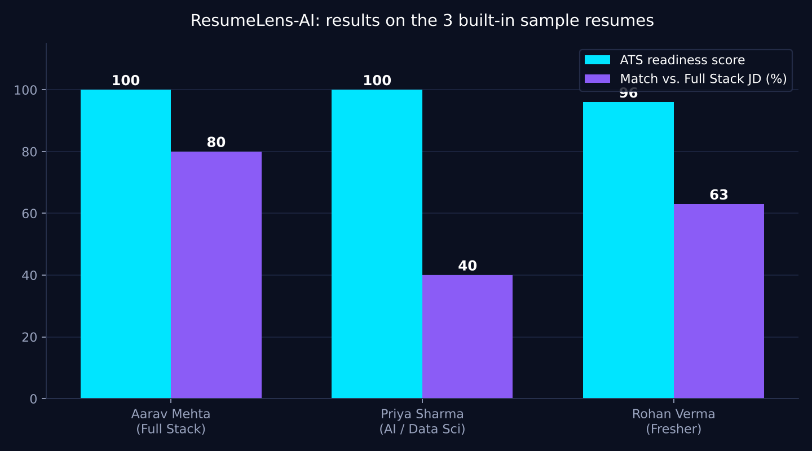

> These samples are synthetic resumes written to be well-structured, so high ATS scores are expected. Real-world resumes will vary.

## 🛠️ Tech Stack

| Layer | Tools |
|---|---|
| Backend | Python, Flask |
| NLP | spaCy (`en_core_web_sm`), regex heuristics |
| Parsing | pdfplumber, python-docx |
| Frontend | Vanilla HTML / CSS / JS (single template) |
| Hosting | Render + gunicorn |

## 🚀 Quick Start

```bash
git clone https://github.com/ShreeyaTapaswi/ResumeLens-AI.git
cd ResumeLens-AI
python -m venv venv && source venv/bin/activate   # Windows: venv\Scripts\activate
pip install -r requirements.txt
python -m spacy download en_core_web_sm
python app.py
```

Open **http://localhost:5000** and click any *instant sample* to try it.

## 🔌 API

```bash
curl -X POST http://localhost:5000/api/parse \
  -F "file=@resume.pdf" \
  -F "jd=We are looking for a Python / Flask developer..."
```

Returns structured JSON (profile, skills, experience, education, ATS report, job match). Max upload: 8 MB.

## ☁️ Deploy on Render

1. Push this repo to GitHub (it includes `render.yaml`).
2. On [Render](https://render.com): **New → Blueprint** → select this repo → **Apply**.
3. Or manually: **New → Web Service**
   - Build: `pip install -r requirements.txt && python -m spacy download en_core_web_sm`
   - Start: `gunicorn app:app --workers 1 --timeout 120 --bind 0.0.0.0:$PORT`

> Free instances sleep after inactivity, so the first load may take ~30–60 s.

## 📁 Project Structure

```
ResumeLens-AI/
├── app.py               # Flask app & /api/parse endpoint
├── resume_parser.py     # Extraction, NLP, ATS scoring, JD matching
├── templates/
│   └── index.html       # Full UI
├── docs/                # Screenshots, demo, results chart
├── render.yaml          # Render blueprint
├── requirements.txt
└── LICENSE
```

## 🗺️ Roadmap

- [ ] OCR for scanned PDFs
- [ ] Persistent candidate database
- [ ] Custom skill taxonomy upload

## 📄 License

Distributed under the [MIT License](LICENSE).

<div align="center">

Built by **[Shreeya S Tapaswi](https://github.com/ShreeyaTapaswi)** · ⭐ Star the repo if you found it useful!

</div>
